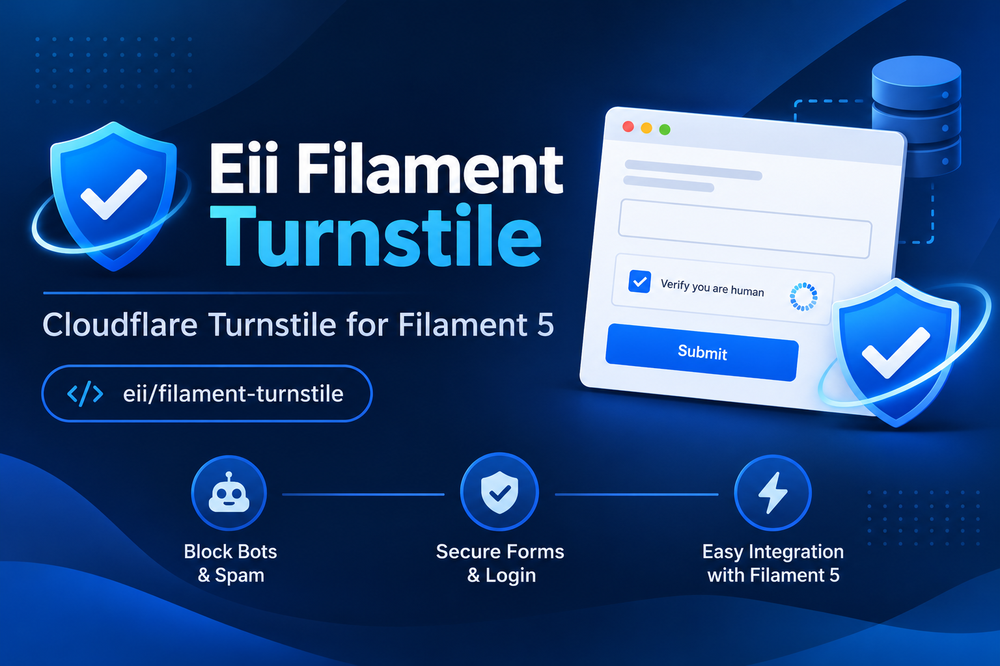

# 🛡️ Eii Filament Turnstile

### Keep bots out. Keep your Filament application protected.

<p align="center">
  
</p>

<p align="center">
  <a href="https://packagist.org/packages/eii/filament-turnstile"></a>
  <a href="https://packagist.org/packages/eii/filament-turnstile"></a>
  <a href="https://packagist.org/packages/eii/filament-turnstile"></a>
  
  
  <a href="https://github.com/amit-eiitech/filament-turnstile"></a>
</p>

**Eii Filament Turnstile** brings Cloudflare Turnstile bot protection directly into your Filament 5 application.

Protect your forms and authentication pages without introducing complicated CAPTCHA workflows or building your own verification infrastructure.

From a reusable form component to ready-to-generate authentication pages, everything is designed to integrate naturally into your existing Filament application.

**Simple to install. Easy to configure. Strict about security.**

---

## ✨ Why Eii Filament Turnstile?

Your Filament application may already have authentication, forms and validation. But automated bots can still target login pages, registration forms and other publicly accessible endpoints.

Cloudflare Turnstile offers a privacy-friendly alternative to traditional CAPTCHA challenges.

This package connects it to Filament and handles the server-side verification that makes the integration meaningful.

### What you get

| Feature | Description |
|---|---|
| 🧩 Reusable Form Component | Add Turnstile verification to any Filament form. |
| 🔐 Authentication Protection | Generate protected Login, Registration and Password Reset pages. |
| 🛡️ Server-side Verification | Verify tokens directly with Cloudflare Siteverify. |
| 🎯 Action-aware Validation | Give each form or authentication flow its own expected action. |
| 🌐 Hostname Allowlisting | Accept verification responses only from configured hostnames. |
| ⚡ Fail-closed Security | Reject requests when verification cannot be completed. |
| 🧪 Testing Support | Use Cloudflare's official test keys for local development and CI. |
| 🔧 Direct Verifier API | Integrate verification into your own application logic. |

### Built with security in mind

This package does not rely on frontend verification alone.

Every submitted token is validated on the server through Cloudflare's Siteverify API. Expected hostnames and actions are checked before verification is accepted.

---

## 📦 Installation

Install the package using Composer:

```bash
composer require eii/filament-turnstile
```

Laravel automatically discovers the package service provider.

### Requirements

| Dependency | Supported Version |
|---|---|
| PHP | 8.2+ |
| Laravel | 11.28+, 12.x, 13.x |
| Filament Forms | 5.x |

The package uses the corresponding Illuminate HTTP and Support components.

---

## ⚙️ Configuration

Publish the configuration file:

```bash
php artisan vendor:publish --tag=filament-turnstile-config
```

Add the following environment variables to your `.env` file:

```env
TURNSTILE_SITE_KEY=your-site-key
TURNSTILE_SECRET_KEY=your-secret-key
TURNSTILE_ALLOWED_HOSTNAMES=yourdomain.com
TURNSTILE_ALLOW_MISSING_ACTION=false
```

You can obtain your Site Key and Secret Key from the [Cloudflare Turnstile Dashboard](https://dash.cloudflare.com/?to=/:account/turnstile).

### Important configuration notes

- `TURNSTILE_ALLOWED_HOSTNAMES` is mandatory. An empty allowlist rejects all verification attempts.
- Multiple hostnames can be separated by commas.
- Enter plain hostnames only. Do not include protocols, paths or ports.
- Keep `TURNSTILE_ALLOW_MISSING_ACTION=false` in production.
- Widget appearance, action names, and HTTP timeouts can be customized through `config/filament-turnstile.php`.

### Customize verification actions

You can configure unique action names for different authentication flows:

```php
'actions' => [
    'login' => 'admin-login',
    'register' => 'admin-register',
    'request_password_reset' => 'admin-password-reset-request',
],
```

---

## 🚀 Usage

### 1. Add Turnstile to any Filament form

Import the component:

```php
use Eii\FilamentTurnstile\Forms\Components\Turnstile;
use Filament\Schemas\Schema;
```

Add it to your Filament form schema:

```php
public function form(Schema $schema): Schema
{
    return $schema->components([
        // Your existing form fields...

        Turnstile::make('turnstile_token')
            ->label('Security Verification')
            ->turnstileAction('admin-users-create')
            ->theme('auto')
            ->size('normal')
            ->appearance('interaction-only'),
    ]);
}
```

That's it! Your form now includes Cloudflare Turnstile verification.

**Available customization options in this example:**

- `turnstileAction()` – Assign an expected action to the verification flow.
- `theme()` – Set the widget theme.
- `size()` – Customize the widget size.
- `appearance()` – Configure widget appearance.

The token field is required and is verified server-side. Never rely solely on the frontend callback.

### Reset the widget after failed submissions

If a form submission fails and you need to reset the widget, dispatch the following Livewire event:

```php
$this->dispatch('eii-turnstile-reset');
```

---

## 🔐 2. Protect Filament Authentication Pages

Don't want to manually build authentication pages?

Eii Filament Turnstile includes Artisan commands that generate custom authentication pages with Turnstile integration.

Run the commands you need:

**Login page**

```bash
php artisan make:filament-turnstile-login
```

**Registration page**

```bash
php artisan make:filament-turnstile-register
```

**Password reset request page**

```bash
php artisan make:filament-turnstile-request-password-reset
```

Each command also supports `--force` to overwrite existing generated files.

### Generated classes

| Command | Generated Class |
|---|---|
| Login | `App\Filament\Pages\Auth\TurnstileLogin` |
| Register | `App\Filament\Pages\Auth\TurnstileRegister` |
| Password Reset | `App\Filament\Pages\Auth\TurnstileRequestPasswordReset` |

Register the generated pages in your Filament Panel Provider.

For example, configure the custom login page:

```php
->login(\App\Filament\Pages\Auth\TurnstileLogin::class)
```

Registration and password-reset wiring may differ depending on your existing panel configuration.

---

## 🎯 3. Action-aware Verification

One of the important features of this package is action-aware validation.

You can use the same Cloudflare Site Key and Secret Key across multiple forms while assigning a different action to each verification flow.

For example:

| Application Flow | Turnstile Action |
|---|---|
| Admin Login | `admin-login` |
| Admin Registration | `admin-register` |
| Password Reset | `admin-password-reset-request` |
| User Creation | `admin-users-create` |
| Order Update | `admin-orders-update` |

### Why does this matter?

**Better analytics**

Cloudflare can distinguish verification traffic by action, making it easier to understand which parts of your application receive automated traffic.

**Stronger validation**

The package checks whether the returned action matches the expected action for that form.

This helps prevent a valid token generated for one flow from being reused in an unrelated flow.

---

## 🧰 4. Use the Verification Service Directly

Need Turnstile verification outside a Filament form?

You can use the package's verifier contract directly in your application.

```php
use Eii\FilamentTurnstile\Contracts\TurnstileVerifier;

$result = app(TurnstileVerifier::class)->verify(
    token: $token,
    remoteIp: request()->ip(),
    expectedAction: 'admin-login',
);

if (! $result->success) {
    // Reject the request.
}
```

This makes the verification service useful for custom controllers, application workflows and other integrations where you need direct control over verification.

---

## 🧪 5. Testing with Cloudflare Test Keys

You don't need production Cloudflare credentials to test the package locally.

Cloudflare provides official test keys that work on localhost and in CI environments.

### Official test key combinations

| Site Key | Secret Key | Expected Result |
|---|---|---|
| `1x00000000000000000000AA` | `1x0000000000000000000000000000000AA` | Always passes |
| `2x00000000000000000000AB` | `1x0000000000000000000000000000000AA` | Always fails |
| `1x00000000000000000000AA` | `3x0000000000000000000000000000000AA` | Token already spent |
| `3x00000000000000000000FF` | `1x0000000000000000000000000000000AA` | Interactive challenge, then passes |

Reference: [Cloudflare – Test your Turnstile implementation](https://developers.cloudflare.com/turnstile/troubleshooting/testing/)

### Example local environment

```env
TURNSTILE_SITE_KEY=1x00000000000000000000AA
TURNSTILE_SECRET_KEY=1x0000000000000000000000000000000AA
TURNSTILE_ALLOWED_HOSTNAMES=example.com
TURNSTILE_ALLOW_MISSING_ACTION=true
```

**Important:** Cloudflare commonly returns `hostname=example.com` and `action=test` when using these test keys.

Make sure your local configuration accommodates the expected hostname and action.

Do not use test keys or relaxed action validation in production.

---

## 🛡️ Security Model

Security is not an optional layer of this integration.

Eii Filament Turnstile implements the following verification safeguards:

| Security Check | Behavior |
|---|---|
| Server-side verification | Every token is checked through Cloudflare Siteverify. |
| Missing token | Rejected. |
| Invalid token | Rejected. |
| Oversized token | Rejected. |
| Hostname validation | Enforces configured hostname allowlist. |
| Action validation | Checks the expected action. |
| Network/API failures | Fails closed. |
| Configuration errors | Fails closed. |
| Sensitive information | Secrets and verification tokens are not logged. |

**Fail-closed behavior:** If Cloudflare verification cannot be completed because of API, network or configuration problems, the package does not treat the request as verified.

---

## 🧩 Current Package Scope

The current release provides:

- Reusable Filament Turnstile form component.
- Server-side verification service.
- Action-aware validation.
- Hostname allowlisting.
- Custom authentication page scaffolding for:
  - Login
  - Registration
  - Password Reset Request
- Direct verifier contract for custom integrations.
- Cloudflare test-key support.

---

## 📚 Useful Links

- **Packagist:** [eii/filament-turnstile](https://packagist.org/packages/eii/filament-turnstile)
- **GitHub Repository:** [amit-eiitech/filament-turnstile](https://github.com/amit-eiitech/filament-turnstile)
- **Cloudflare Turnstile:** [Official Documentation](https://developers.cloudflare.com/turnstile/)
- **Cloudflare Test Keys:** [Testing Documentation](https://developers.cloudflare.com/turnstile/troubleshooting/testing/)

---

## 🤝 Contributing

Found an issue, have an improvement in mind, or want to contribute?

Contributions, bug reports and feature suggestions are welcome.

Feel free to open an issue or submit a pull request through the GitHub repository.

---

## 📄 License

This package is open-sourced software licensed under the [MIT License](LICENSE).

---

<p align="center">
  **Developed with ❤️ by Eii Tech Solutions**
  
  <a href="https://eiitechsolutions.com">eiitechsolutions.com</a>
</p>

<p align="center">
  If you find this package useful, consider giving it a ⭐ on GitHub!
</p>
